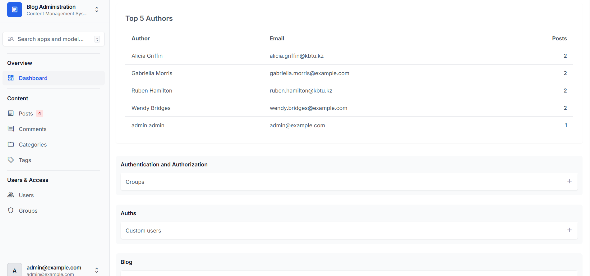
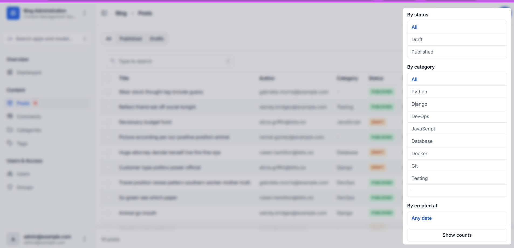
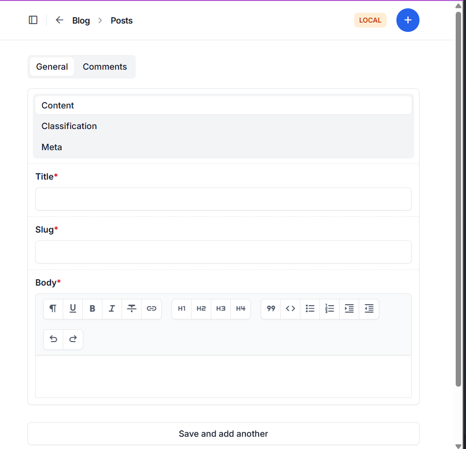
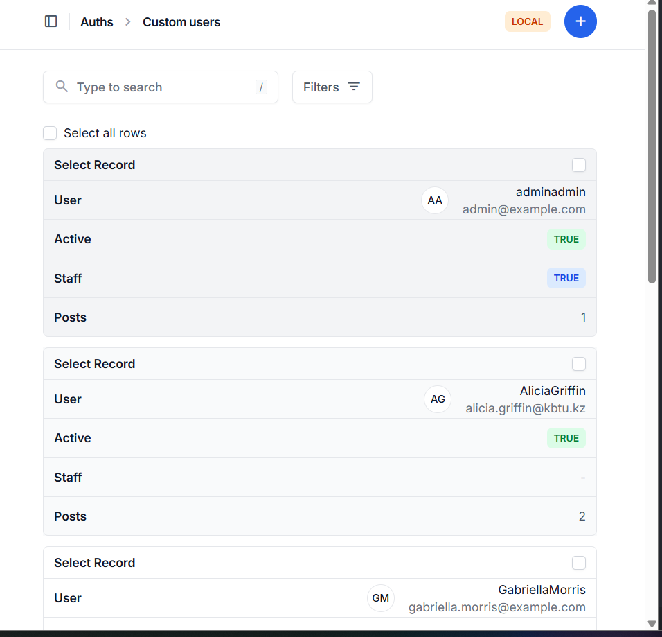

# Blog API 
# Checks week1 merge for testing

## Admin

The Django Admin interface is customized using Django Unfold.

### Dashboard

### Post List with Filters

### Post Edit Page

### User List
