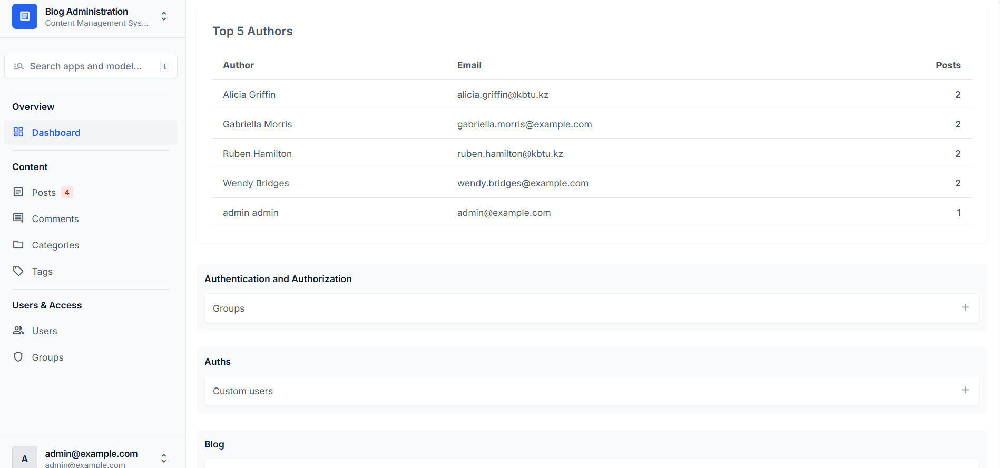
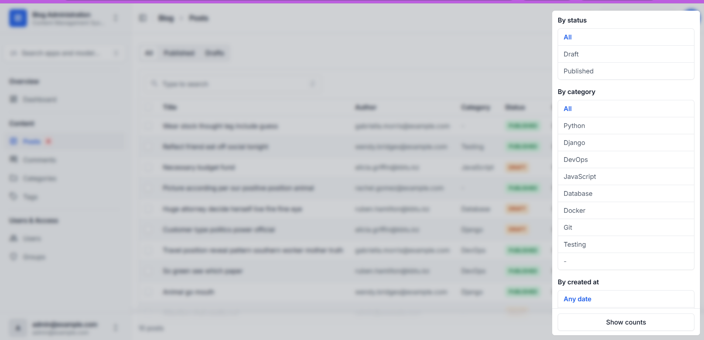
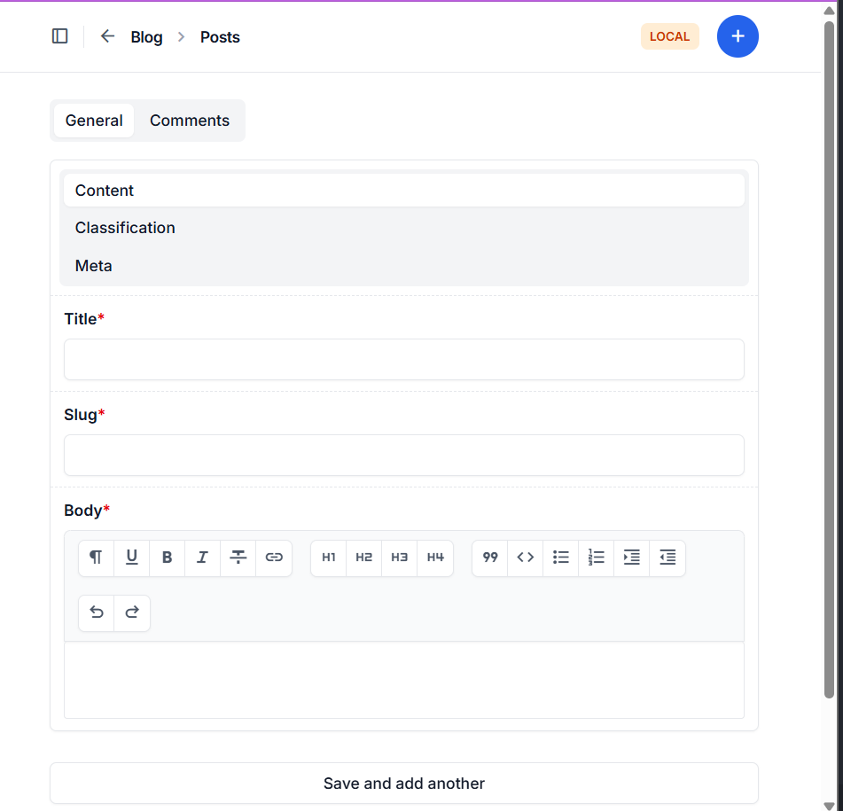
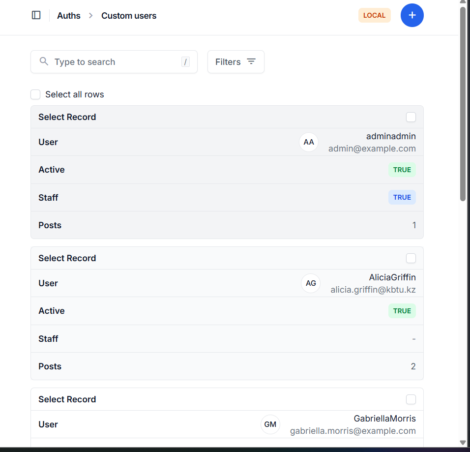

# Blog API 
# Checks week1 merge for testing


## Admin

The Django Admin interface is customized using Django Unfold.

### Dashboard


### Post List with Filters


### Post Edit Page


### User List



# Blog API --- Homework 3

This homework focuses on Django ORM. It contains 50 database queries,
realistic date generation in the seed command, and a custom management
command for running and inspecting queries.

## Requirements

-   Python 3.12
-   Django 5.2 or newer
-   The dependencies already listed in the project's requirements files

No additional packages are required for Homework 3.

## Setup

Activate the virtual environment and install the project dependencies:

``` bash
# Windows PowerShell
.venv\Scripts\Activate.ps1

pip install -r requirements/dev.txt
```

Apply database migrations:

``` bash
python manage.py migrate
```

## Seed Database

Generate sample users, categories, tags, posts, and comments:

``` bash
python manage.py seed
```

To clear the existing generated data and create a fresh dataset:

``` bash
python manage.py seed --clear
```

The seed command generates realistic dates:

-   Every post receives a random `created_at` date within the last 365
    days.
-   About 30% of posts receive an `updated_at` date 1--30 days after
    `created_at`, without going beyond the current time.
-   The remaining posts have `updated_at` equal to `created_at`.
-   Every comment receives a random `created_at` date between its post's
    creation date and the current time.

The date updates use bulk operations; the seed command does not call
`.save()` in a loop.

## ORM Queries

The 50 query functions are implemented in:

``` text
apps/blog/queries.py
```

The custom management command is:

``` text
apps/blog/management/commands/queries.py
```

Run all read-only queries:

``` bash
python manage.py queries
```

This runs queries **1--39 and 45--50**. Queries 40--44 are excluded
because they modify database records.

Run one query by its number:

``` bash
python manage.py queries --number 31
```

Print the SQL generated by Django:

``` bash
python manage.py queries --number 6 --sql
```

Queries 40--44 can also be run individually with `--number`. They change
database data, so use them carefully. To restore a fresh sample dataset
afterward, run:

``` bash
python manage.py seed --clear
```

### Example output

``` text
#31 categories_with_post_count — 1 SQL query
Django {'post_count': 15}
Docker {'post_count': 14}
Git {'post_count': 12}
JavaScript {'post_count': 12}
Python {'post_count': 11}
(8 rows)
```

The command displays the query number, function name, number of SQL
queries, and result. For a QuerySet or list, it displays up to the first
five rows and the total number of rows.

## Verification

To verify the project from a newly migrated database, run:

``` bash
python manage.py migrate
python manage.py seed
python manage.py queries
python manage.py queries --number 41
```

To inspect a particular SQL query, add the `--sql` option:

``` bash
python manage.py queries --number 31 --sql
```

## Git Workflow

Homework 3 work is developed on the `hw3` branch. After completing and
checking the work, merge `hw3` into `main` and keep the `hw3` branch.
